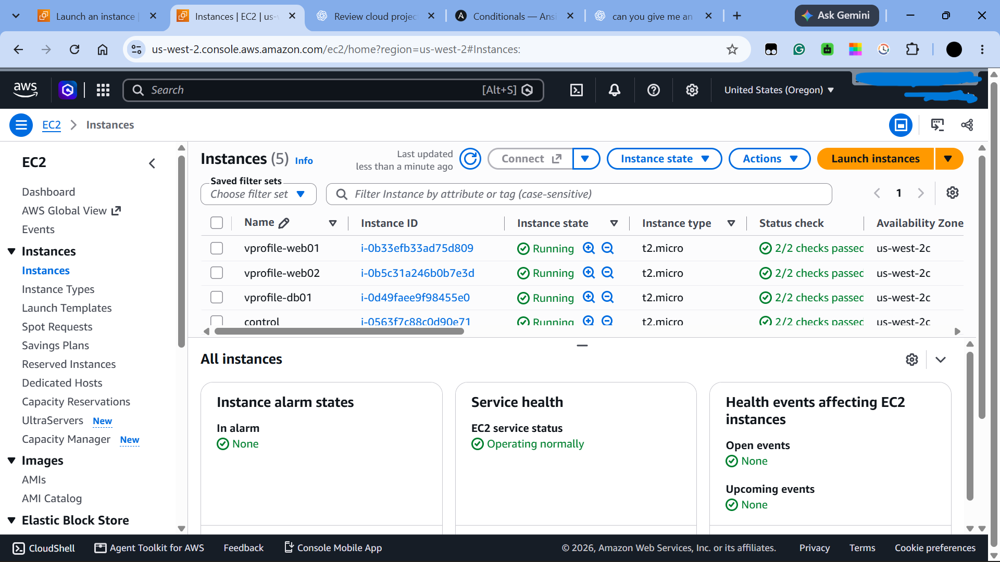
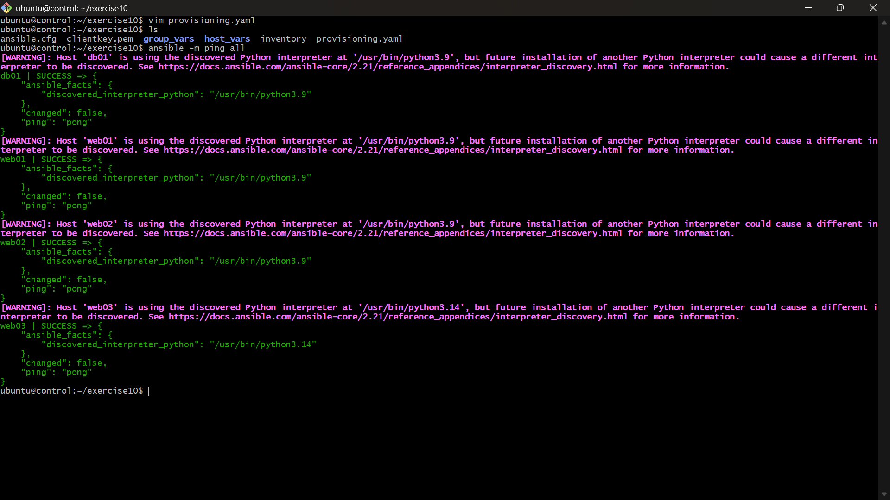
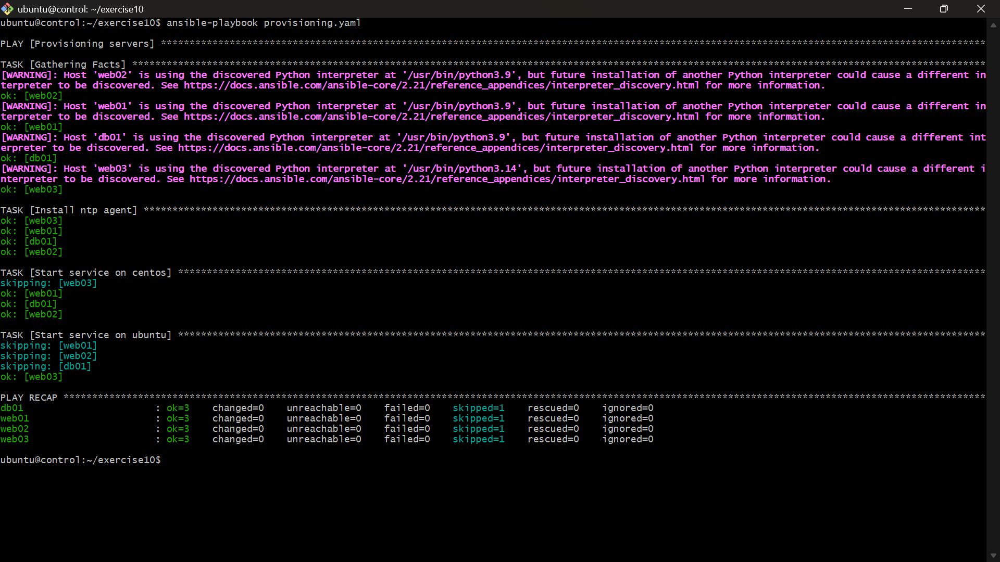
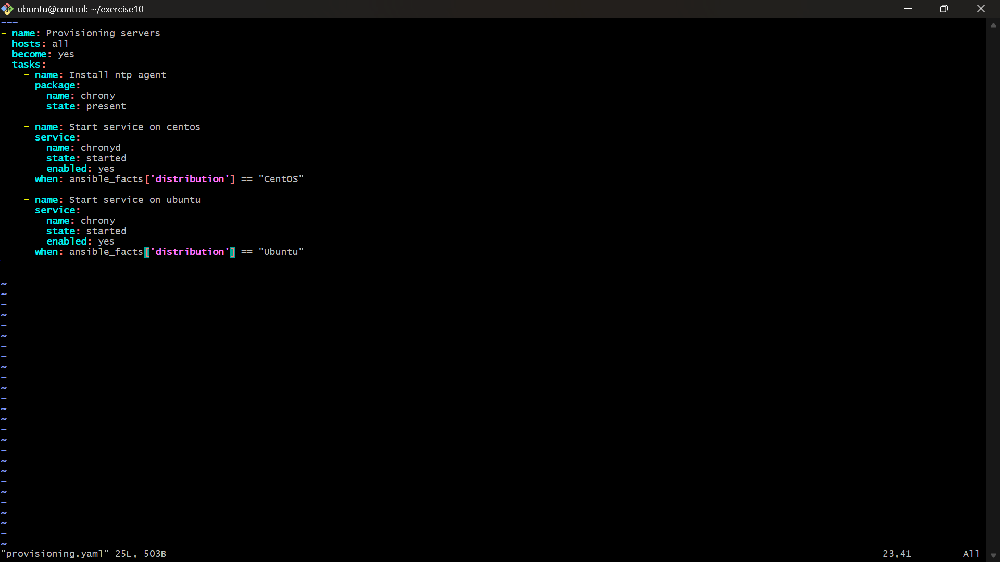
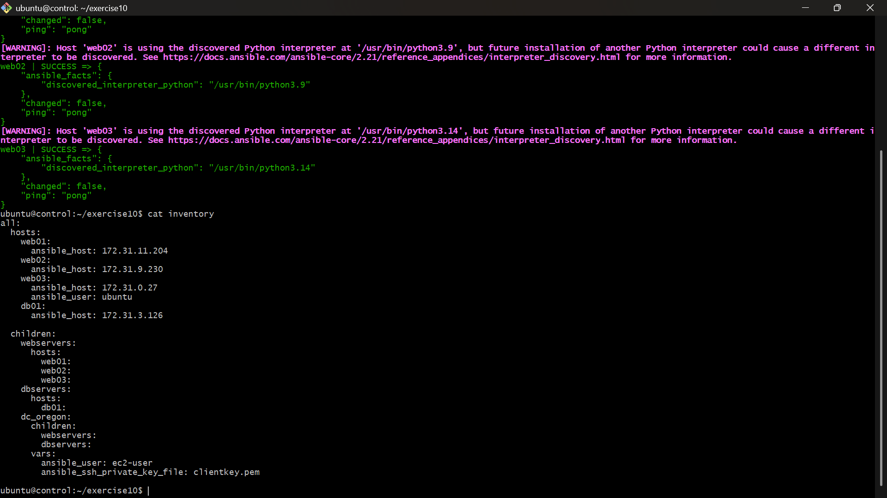

# Ansible Multi-Server Provisioning

## Project Overview

This project demonstrates configuration management and multi-server provisioning using Ansible on AWS EC2 instances.

Ansible is configured on a central control node to manage multiple remote Linux servers through SSH. The project uses an inventory file to organize hosts into logical groups, Ansible variables to manage configuration, and conditional tasks to handle differences between Linux distributions.

It also demonstrates Ansible variable precedence through `group_vars` and `host_vars`.

## Architecture

The project uses an AWS EC2-based environment consisting of an Ansible control node and four managed nodes.

| Machine | Role | Operating System |
|---|---|---|
| Control node | Ansible controller | Ubuntu Server |
| web01 | Web server | CentOS |
| web02 | Web server | CentOS |
| web03 | Web server | Ubuntu Server |
| db01 | Database server | CentOS |

The Ubuntu control node connects to the managed nodes over SSH and executes configuration management tasks remotely.

## Technologies Used

- Amazon Web Services (AWS)
- Amazon EC2
- Ubuntu Linux
- CentOS
- Ansible
- YAML
- SSH
- Git and GitHub

## Repository Structure

```text
ansible-multi-server-provisioning/
│
├── screenshots/
│   ├── 01-ec2-instances.png
│   ├── 02-ansible-connectivity.png
│   ├── 03-playbook-execution.png
│   ├── 04-provisioning-playbook.png
│   └── 05-inventory-structure.png
│
├── group_vars/
│   ├── all
│   └── webservers
│
├── host_vars/
│   └── web02
│
├── .gitignore
├── ansible.cfg
├── inventory
├── provisioning.yaml
└── README.md
```

## Implementation

### 1. Infrastructure Setup

Created AWS EC2 instances to serve as the Ansible control node and managed nodes.

The control node is responsible for executing Ansible commands and playbooks against the remote servers.

### 2. Inventory Configuration

Configured a YAML-based inventory to define the managed hosts and organize them into logical groups.

The inventory includes:

- Individual web servers.
- Database servers.
- A parent group for organizing infrastructure.
- Group-level connection variables.

Actual IP addresses and private key paths have been replaced with placeholders for security.

### 3. Ansible Configuration

Configured Ansible through `ansible.cfg` to specify project-level settings, including:

- Inventory location.
- SSH host key checking.
- Parallel execution settings.
- Log file location.
- Privilege escalation settings.

### 4. Multi-Distribution Provisioning

The environment includes Ubuntu and CentOS managed nodes. The `provisioning.yaml` playbook automates the installation and configuration of the Chrony time synchronization service across both distributions.

The playbook uses Ansible's generic `package` module to install `chrony` on all managed nodes. This module abstracts the underlying package manager, allowing the same task to install packages across different Linux distributions.

It then uses separate conditional tasks to manage the service based on the operating system.

| Configuration | Ubuntu | CentOS |
|---|---|---|
| Package manager | APT | YUM/DNF |
| Package name | chrony | chrony |
| Service name | chrony | chronyd |

The playbook performs three tasks:

1. **Install NTP agent:** Installs the `chrony` package across all managed nodes.
2. **Start service on CentOS:** Starts and enables `chronyd` when the managed node runs CentOS.
3. **Start service on Ubuntu:** Starts and enables `chrony` when the managed node runs Ubuntu.

This demonstrates the use of Ansible's generic modules, facts and conditional execution to manage differences between Linux distributions without maintaining separate playbooks.

### 5. Variable Precedence

Demonstrated Ansible variable organization and precedence using:

- `group_vars/all` – Variables available to all inventory hosts.
- `group_vars/webservers` – Variables assigned to members of the webservers group.
- `host_vars/web02` – Variables specific to the web02 host.

The same variable names (`USRNM` and `COMM`) are defined at different inventory levels to demonstrate how Ansible resolves conflicting variable definitions.

The demonstration follows this precedence:

1. `group_vars/all` provides the default variable values.
2. `group_vars/webservers` overrides the default values for hosts belonging to the webservers group.
3. `host_vars/web02` overrides the group-level values specifically for web02.

This illustrates how Ansible applies variable precedence when multiple definitions exist for the same variable.

## Validation and Results

The configuration was validated using Ansible commands and playbook execution.

**Connectivity Testing**

Used the Ansible ping module to verify SSH connectivity between the control node and all four managed nodes.

```bash
ansible all -m ping
```

All four managed nodes returned successful responses.

**Playbook Execution**

Executed the provisioning playbook against all managed nodes.

```bash
ansible-playbook provisioning.yaml
```

The playbook completed successfully:

- All four managed nodes completed the applicable tasks.
- Distribution-specific service tasks executed according to the operating system.
- Non-applicable conditional tasks were skipped.
- No failed or unreachable hosts were reported.

## Screenshots

### AWS Infrastructure

Shows the EC2 instances used for the Ansible control node and managed infrastructure.



### Ansible Connectivity Test

Demonstrates successful connectivity between the control node and managed nodes using Ansible's ping module.



### Playbook Execution

Shows the successful execution of the provisioning playbook across the managed infrastructure.



### Provisioning Playbook

Shows the Ansible playbook containing package installation and distribution-specific service management tasks.



### Inventory Structure

Demonstrates host grouping, nested inventory groups and connection variables.



## Running the Project

### Prerequisites

- Ansible installed on the control node.
- AWS EC2 instances running and accessible.
- SSH private key with appropriate permissions.
- Network access between the control node and managed nodes.

### 1. Clone the repository

```bash
git clone <your-repository-url>
cd ansible-multi-server-provisioning
```

### 2. Configure the inventory

Update the `inventory` file with your EC2 private IP addresses and appropriate SSH usernames.

Configure the private key path using your own SSH key.

Do not commit private keys or credentials.

### 3. Verify connectivity

```bash
ansible all -m ping
```

### 4. Inspect inventory groups

```bash
ansible-inventory --graph
```

### 5. Inspect host variables

```bash
ansible-inventory --host web02
```

### 6. Execute the provisioning playbook

```bash
ansible-playbook provisioning.yaml
```

## Security Considerations

- Private SSH keys are excluded through `.gitignore`.
- Sensitive infrastructure details should be replaced with placeholders before publishing.
- Actual credentials and environment-specific configuration should never be committed to a public repository.
- Managed nodes should only permit SSH access from trusted sources.

## Key Learnings

Through this project, I gained practical experience with:

- Configuring Ansible to manage multiple AWS EC2 instances.
- Organizing infrastructure using static inventories and nested host groups.
- Establishing SSH connectivity between a control node and managed nodes.
- Automating package installation and service management.
- Using conditional execution for different Linux distributions.
- Understanding Ansible variable organization and precedence.
- Managing configuration files and sensitive information in Git.

## Future Improvements

- Convert the static inventory into a dynamic AWS EC2 inventory.
- Refactor provisioning tasks into reusable Ansible roles.
- Introduce Ansible Vault for sensitive variables.
- Integrate provisioning into a CI/CD pipeline.